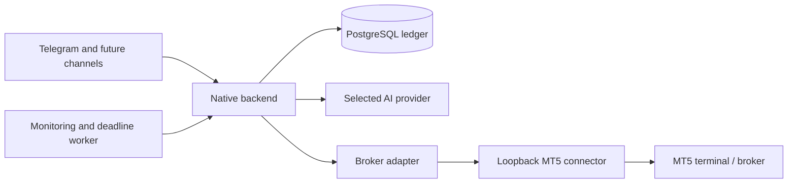

# Architecture

Trade Agent is a human-confirmed execution system. Its native backend owns the
execution ledger, validation, confirmation state, deadlines, and notifications.
An AI provider can turn a Telegram message into a trade draft, but it does not
receive execution credentials and it cannot submit an order.

## Process boundaries

`trade-agent` is a native Python service on both Windows and Ubuntu. It exposes
the private application API, accepts Telegram updates, checks every proposed
entry against deterministic policy, writes durable ledger records, and runs the
monitoring and deadline workers. PostgreSQL is the source of truth for actions
and recovery. LangGraph stores resumable conversation clarification state in a
separate PostgreSQL checkpointer; those checkpoints are never execution records.

`trade-agent-connector` is a second process with the only MT5 dependency. It
listens on loopback only and authenticates every request using the connector
token. On Windows it runs beside the desktop MT5 terminal. On Ubuntu 26.04 it
runs under Wine using Windows Python in a dedicated Wine prefix. The connector
environment must never be shared with the native backend environment.

The backend connects to an `AIBackend` selected explicitly by configuration:
OpenAI-compatible, OpenCode, or Codex. Each backend may produce structured
drafts and human-readable messages only. Application services validate the
draft against account, instrument, quote, and policy data before presenting a
versioned confirmation. The execution service rechecks those facts after the
confirmation and before it contacts the connector.

## Execution model

Each trade has an immutable proposal version and a five-minute confirmation
token. Any edit creates a new version and invalidates older tokens. A confirmed
proposal creates one execution intent with an idempotency key. A timed-out
connector request is recorded as `unknown`; reconciliation queries MT5 state
and history before any later action. It is never retried as a blind duplicate.

Protection changes use their own immutable action proposal and one-time
confirmation. Every submit, modify, cancel, and close has a durable idempotency
key shared with the connector journal. The broker receives stop loss and take profit with the order. The backend also
maintains a durable deadline job: at the deadline it cancels a still-pending
order or closes the remaining position. Entry pauses do not block this
risk-reducing work. Reconciliation after restart handles overdue jobs before
new entries become eligible.

The database migrations create these authoritative records:

| Table | Purpose |
| --- | --- |
| `proposals` | Versioned trade draft, validation result, expiry, and deadline |
| `execution_intents` | Idempotent submission state and MT5 identifiers |
| `action_proposals` | Confirmed, versioned SL/TP modification requests |
| `mutation_intents` | Durable modify, cancel, and close operations |
| `ledger_events` | Append-only audit events |
| `notification_outbox` | Durable, deduplicated Telegram delivery work |
| `incoming_updates` | Telegram update deduplication |
| `system_state` | Pause and other durable service state |

## Network and secrets

All inbound listening sockets are private. Every `/v1` backend operation also
requires `X-Trade-Agent-Token`, and owner-bound requests must match the configured
Telegram owner. The normal deployment binds the
backend to `127.0.0.1:8100`, the connector to `127.0.0.1:8101`, and PostgreSQL
to `127.0.0.1:5432`. Telegram, model providers, and the broker terminal make
outbound connections. Put a separately authenticated reverse proxy in front of
the backend only if an external API is deliberately enabled.

Database URLs, Telegram tokens, provider credentials, broker credentials, and
the connector token are deployment secrets. Inject them through protected
service environment files or the host secret store. Do not place them in source
control, logs, command lines, model prompts, or screenshots. The AI processes
receive only the minimum trade context needed to build a draft.

See [OPERATIONS.md](OPERATIONS.md) for the Windows and Ubuntu runbooks.
