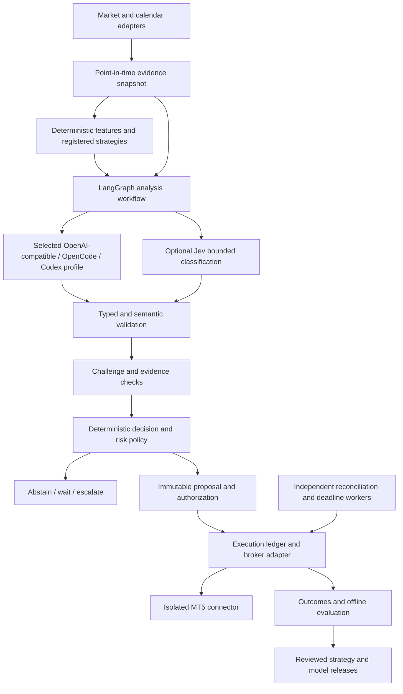

# Trading intelligence roadmap

Status: proposed architecture and implementation plan; not an activation of autonomous trading.

Prepared: 2026-09-27. Target: native Windows backend and Ubuntu 26.04 backend with an isolated Windows MT5 connector under Wine.

## 1. Recommendation

Build a hybrid decision harness around the existing deterministic trading application. LangGraph coordinates evidence collection, analysis, challenge, and proposal creation. Numerical code computes features and risk. The execution ledger, broker adapter, approval rules, reconciliation, and deadline worker remain the authority over orders.

Retain OpenAI-compatible, OpenCode, and Codex profiles for analysis. Add TypeSafe AI Jev only as an optional, separately evaluated decision component. No model, including Jev, should directly call MT5 or override execution policy.

The first useful intelligence release should explain current conditions, identify missing evidence, and produce reviewable suggestions in shadow mode. It should not begin with an unrestricted agent that browses, writes strategies, and trades its own conclusions.

This document proposes future work. It builds on the previous project review; the terminal could not start during preparation, so current files and tests were not freshly verified. Previously reported test results do not establish deployment readiness. The reliability issues below must be confirmed and resolved before accepting unattended operation.

## 2. What intelligence means here

An intelligent run should answer these questions with traceable evidence:

1. What information was actually available at the decision time?
2. Is that information fresh, internally consistent, and sufficient?
3. Does a registered strategy identify a candidate setup?
4. What supports the candidate, and what would invalidate it?
5. Is doing nothing preferable under the configured policy?
6. If a proposal is appropriate, what exact action is authorized and for how long?
7. What happened afterward, and what should be evaluated offline?

Use four separate concepts: market prediction, language-based analysis, decision routing, and execution authorization. A convincing explanation is not evidence of predictive accuracy. A valid JSON response is not evidence of an economically sound trade. Abstention is a successful outcome when evidence or authority is insufficient.

Initial research should use closed bars and modest decision frequency. Select instruments and timeframes explicitly during research; no timeframe or strategy in this plan implies an established trading edge. Tick-sensitive strategies and high-frequency execution are outside this architecture's initial acceptance scope.

## 3. Repair the foundation first

Read-only research can proceed alongside these repairs, but trade proposals and autonomy depend on their acceptance.

| ID | Work | Required evidence |
|---|---|---|
| F01 | Replace process-local account serialization with database-backed account coordination and durable capacity reservations. Cover API, Telegram, workers, and multiple application instances. | Concurrent PostgreSQL tests prove total reserved plus actual exposure cannot exceed configured limits. |
| F02 | Complete submission and mutation recovery. A timeout means unknown; an empty open-order list alone does not prove rejection or closure. Align connector journal lookup keys across every operation. | Crash and timeout injection before and after connector calls; no blind resubmission or duplicate execution. |
| F03 | Represent order, deal, and position identifiers independently, including multiple fills and netting/hedging ownership. | Partial fill, fill/cancel race, delayed history, external trade, and netted-position scenarios. |
| F04 | Make deadline exits durable and independent of model calls and notification delivery. Retry only after resolving the preceding attempt. | Overdue restart, disconnect, market closure, partial closure, and blocked notification drills. |
| F05 | Persist complete incoming Telegram updates before acknowledgment through controlled polling or a durable webhook inbox. Store processing state and response outbox atomically where appropriate. | Redelivery and crash tests recover the command and its confirmation UI without executing it twice. |
| F06 | Isolate conversation sessions and reset completed drafts. Do not inherit trade fields from an old conversation without explicit user intent. | Multi-trade clarification tests, changed proposal tests, and stale confirmation rejection. |
| F07 | Require explicit account and financial limits. Extend aggregate risk measurement in account currency and distinguish entry limits from authorized exits. | Real broker specification fixtures and boundary tests for volume, tick, margin, currency conversion, and exposure. |
| F08 | Enforce provider isolation through operating-system identities, filesystem permissions, restricted tools, and network boundaries. A temporary working directory is insufficient. | Attempts to read broker/database secrets, invoke execution, or reach forbidden services are denied. |
| F09 | Complete deployment acceptance on both operating systems. | PostgreSQL integration, all three provider protocols, connected demo sessions, reboot/disconnect tests, and restored-backup reconciliation. |

For account mutations, use a durable command queue or short database transactions that claim account leases and reserve capacity. Avoid holding database transactions open across slow provider calls. Broker calls require a persisted intent first. An expired worker lease does not prove that an in-flight broker operation stopped: retain unknown intents and reconcile before another worker sends anything. A connector must reject concurrent processing of the same idempotency key and have a documented single-writer deployment boundary.

Do not promise distributed exactly-once delivery. Aim for durable at-least-once processing, idempotent local actions, conservative uncertainty handling, and broker reconciliation.

## 4. Architecture and decision rights



| Component | May do | Must not do |
|---|---|---|
| Data/feature services | Normalize data, calculate indicators and account-currency quantities | Invent missing observations or silently forward-fill critical prices |
| Analyst | Summarize evidence, propose scenarios, identify uncertainty | Submit trades, infer missing owner inputs, or set deployment limits |
| Challenger | Find unsupported claims, contradictory evidence, and invalid assumptions | Treat agreement between models as independent proof |
| Jev decision adapter | Classify a bounded question against supplied evidence | Authorize a trade from a confidence score |
| Policy engine | Apply versioned rules and choose abstain/propose/escalate | Silently weaken a failed rule |
| Execution service | Validate authorization and current state, persist intent, call broker | Trust narrative text as approval |
| Evaluation pipeline | Compare outcomes and suggest reviewed changes | Rewrite or deploy live strategies automatically |

Begin with one analyst and an optional challenger pass, not a swarm. Challenger use should be justified by measured defect reduction. Parallelize independent data reads and analysis when useful, but serialize account mutations. Multiple model opinions often share the same data and biases.

## 5. Autonomy levels

| Level | Behavior | Promotion requirement |
|---|---|---|
| A0: manual automation | Execute exact user-confirmed instructions; monitor existing exits | Phase 1 acceptance |
| A1: read-only analyst | Explain market/account observations; cannot create executable actions | Evidence accuracy and isolation tests |
| A2: shadow decisions | Record hypothetical proposals and outcomes without broker submission | Reproducible datasets, simulator, and research protocol |
| A3: assisted proposals | Suggest exact trades; one user confirmation for each immutable proposal | F01–F09 complete and forward evaluation accepted |
| A4: constrained demo autonomy | Execute only within an explicitly approved, expiring policy grant | Demo promotion review and fault drills |
| A5: optional constrained live autonomy | Same controls against an explicitly configured live account | Separate user authorization and deployment acceptance |

A policy grant records owner, account fingerprint, environment, strategy version, model/profile versions, instrument allowlist, position/exposure/loss limits, permitted operations, validity interval, and revocation state. Define precedence: deployment prohibitions and global pauses override grants; grants cannot increase deployment limits. Revocation blocks unsubmitted entries immediately. Already authorized protective exits continue.

A3 retains the five-minute confirmation lifetime unless explicitly changed. Any edit to execution details creates a new proposal version. Evidence or prices can invalidate a still-unexpired confirmation. At A4/A5 the policy grant replaces per-trade confirmation only for its exact scope; this is a future feature, not implied authorization from this document.

Changing an existing trade's SL, TP, deadline, or size requires the applicable explicit authorization. Initial intelligence must not loosen stops, average down, or extend deadlines on its own. Stop-based loss estimates are limits for planning, not guarantees against gaps or slippage.

## 6. Data and evidence design

Create read-only adapters for MT5 quotes, closed bars, instrument specifications, account snapshots, and a separately selected economic-calendar feed. News is optional and should follow structured market-data support. Use broker bid/ask information where execution realism matters; do not simulate fills exclusively from midpoint closes.

Every observation needs source, instrument mapping, event time, publication time when available, received time, availability time, revision identifier, and quality flags. Every decision has an immutable `as_of` cutoff. A backtest may use only the version actually available by that cutoff. Revised economic releases and later-corrected bars must not replace original historical knowledge silently.

Create a `SnapshotManifest` referencing immutable observations, feature implementation versions, content hashes, and freshness checks. Keep metadata in PostgreSQL; larger historical datasets can live in versioned Parquet files with manifests and backup checksums. An object store can be introduced later; it is not a prerequisite. Store financial order quantities as decimals and all timestamps in UTC, displaying Asia/Kolkata by default.

Configure freshness by feed and strategy: quote age, completed-bar age, calendar validity, account snapshot age, maximum clock drift, and maximum missing observations. Invalid critical evidence produces `ABSTAIN`, not a request for the LLM to guess. Detect broker suffix mappings, duplicate events, stale prices, out-of-order ticks, daylight-saving changes, market sessions, and abnormal spreads.

Treat web/news content as untrusted data. Extract bounded fields and provenance; do not execute embedded instructions. Models receive only selected evidence and pseudonymous account context. Data licensing, retention, revision access, and redistribution rights are feed-selection requirements.

## 7. Strategies, prediction, and analysis

Maintain a versioned registry of approved strategy templates. Each template defines input requirements, feature calculations, candidate conditions, invalidation conditions, intended holding horizon, entry/exit construction, and compatible instruments. An LLM may explain or challenge a candidate; it must not generate arbitrary executable strategy code inside the trading runtime.

Start with a deterministic baseline and compare every AI addition against it. Record whether the analyst improves evidence quality, reduces invalid proposals, or improves forward decision outcomes after costs. If it adds cost and narrative without measurable benefit, remove it from that decision path.

Future predictive models belong behind a separate `ForecastModel` interface. They may estimate a specified outcome distribution over a fixed horizon only after calibration and out-of-sample evaluation. Keep predicted probabilities, Jev classification confidence, and language-model self-assessment in separate fields. Never rename any of these generically to `trade_confidence`.

If expected value is used, calculate it from a defined outcome distribution and subtract modeled spread, commissions, slippage, financing, and other relevant costs. If a credible distribution is unavailable, do not fabricate expected value. Sizing is a separate deterministic policy using validated account state, instrument rules, and risk budgets; retain user-specified lots until that future feature is deliberately introduced.

## 8. LangGraph harness

Use explicit nodes with typed state:

1. `load_request`: identify owner, account, run mode, selected profile, and strategy version.
2. `capture_snapshot`: freeze evidence with a decision cutoff and manifest.
3. `check_data_quality`: reject stale, missing, or contradictory critical inputs.
4. `compute_features`: run deterministic calculations and strategy candidates.
5. `analyze`: request structured claims and scenarios with evidence references.
6. `validate_analysis`: reject unknown evidence IDs, unsupported quantities, and malformed output.
7. `challenge`: test material claims against alternative explanations and invalidation rules.
8. `route_optional_jev`: classify narrowly scoped questions when the evaluated profile enables it.
9. `decide_by_policy`: return `ABSTAIN`, `WAIT`, `ESCALATE`, or `PROPOSE` with reason codes.
10. `persist_result`: save the decision and, if appropriate, a versioned proposal.
11. `await_authorization`: use the application approval service or a valid scoped grant.

Execution belongs to the existing application service, outside model tool access. Recheck the account, market, evidence expiry, policy version, authorization, and reservations immediately before submission. If conditions have materially changed, invalidate the proposal and require a new decision/approval where applicable.

Bound the workflow: finite graph transitions, per-node timeouts, maximum model calls, token/cost budgets, maximum evidence size, and a run deadline. Do not permit open-ended self-reflection loops. Limits are deployment configuration; benchmark them before choosing defaults. On exhausted budget or failed validation, persist an abstention with an operational reason.

LangGraph checkpoints support workflow recovery, but are not the execution ledger. Resume a run against its immutable snapshot; if that evidence expired, terminate it and create a new run. Persist node result keys so replay does not duplicate notifications or proposals. Checkpoint replay must never imply order resubmission. [LangGraph persistence documentation](https://docs.langchain.com/oss/python/langgraph/persistence)

## 9. Typed contracts and storage

Introduce contracts before provider-specific implementation:

| Contract | Essential fields |
|---|---|
| `AnalysisRequest` | run ID, mode, snapshot ID, strategy version, explicit question, output schema version |
| `EvidenceClaim` | claim ID, concise statement, evidence IDs, support/contradiction status |
| `AnalysisResult` | scenarios, claims, missing evidence, invalidation conditions, concise rationale |
| `DecisionResult` | outcome enum, reason codes, policy version, evidence validity, optional candidate ID |
| `TradeCandidate` | exact instrument/direction/type/entry/SL/TP/volume source/deadline and provenance |
| `RiskAssessment` | account snapshot, limits, reservations, measurements, failed checks |
| `AuthorizationGrant` | scope, immutable versions, issuer, expiry, revocation |
| `DecisionOutcome` | decision ID, related orders/deals/positions, costs, observed result, attribution |

Use Pydantic for boundary validation and explicit semantic validators for cross-field rules. Schema validity alone cannot establish evidence support. Reject invented prices, unsupported citations, non-finite values, unit mismatches, and missing required execution fields. Persist concise decision explanations and evidence references rather than requiring private model chain-of-thought.

Add tables for snapshot manifests, analysis runs, claims, decisions, evaluations, strategy releases, policy grants, and model/profile releases. Link proposals and execution intents to their originating decision; retain manual proposal support. Use foreign keys and unique constraints for stable run/result identities. Audit records should identify who authorized what and under which exact versions.

## 10. TypeSafe AI Jev: optional, measured adoption

The user's reference to “typesafe ai jav” is interpreted as **TypeSafe AI Jev**. The official documentation describes typed decision questions including `Choice`, `Score`, and `Noul`; Choice and Score responses include probabilities and confidence. Questions in one request are evaluated independently against the supplied state. Design sequential dependencies in the harness rather than assuming one question sees another's answer. [TypeSafe AI documentation](https://docs.typesafe.ai/introduction)

Good first evaluation tasks are evidence relevance, missing-information routing, contradiction classification, and escalation against a written rubric. Avoid starting with “buy or sell?” because a classification score does not establish a calibrated probability of future market profit.

Add a `DecisionBackend` separate from `AnalysisBackend`, with a disabled-by-default `JevDecisionBackend`. The three existing analysis providers remain explicit choices. Do not silently fall back to Jev or another credential/billing route when an analysis provider fails. Pydantic, Pydantic AI, and TypeSafe AI are distinct technologies; no additional agent framework is required just to validate typed outputs.

Adoption experiment:

1. Build a labeled, versioned corpus from representative evidence snapshots, including adversarial, ambiguous, and missing-data cases.
2. Define the label rubric and abstention behavior before evaluating models.
3. Compare deterministic rules, the selected analysis provider, and Jev on the identical holdout set.
4. Measure per-class precision/recall, critical-error rate, latency, cost, calibration, and accuracy at different abstention coverage levels. Use probability calibration metrics only for well-defined labels with observed ground truth.
5. Choose thresholds using validation data, then freeze them for final holdout and shadow evaluation. Do not invent a universal confidence threshold.
6. Pin model/API/SDK versions where supported; record immutable identifiers or deployment metadata where a provider does not offer fixed versions. Reevaluate changes.

Adopt Jev only if measured benefits justify another external dependency. Verify authentication, service availability, data handling, retention, pricing, and version guarantees before implementation. Vendor performance claims are not trading-system acceptance evidence. The published Jev/LangGraph example supports the architectural pairing, but does not establish financial suitability. [LangChain engineering article](https://www.langchain.com/blog/building-prod-with-jev-and-langgraph)

## 11. Evaluation without fooling ourselves

Separate software correctness, analytical quality, and economic performance. Passing one does not establish the others.

Software evaluation covers unauthorized execution, duplicate processing, crash recovery, stale evidence, approval invalidation, account changes, malformed provider output, tool injection, rate limits, expired authentication, and simultaneous commands. Run PostgreSQL and connector contract tests in addition to fast fake-broker tests.

Analytical evaluation checks whether claims cite valid evidence, numbers match deterministic calculations, missing information causes abstention, and explanations remain consistent with the proposed action. Use human-labeled cases and deterministic assertions, not only another LLM as judge.

Research evaluation uses chronological training/validation/test partitions, rolling walk-forward analysis, and separation of overlapping outcome horizons. Keep a final untouched holdout. Record every strategy, prompt, model, and parameter trial so selection bias is visible. Repeatedly selecting the best backtest can produce misleading results. [Bailey et al., The Probability of Backtest Overfitting](https://www.davidhbailey.com/dhbpapers/backtest-prob.pdf)

Simulations must model bid/ask, commissions, variable spreads, slippage, financing, order expiration, minimum volume/ticks, partial fills where relevant, and rejected/disconnected execution. If OHLC bars cannot determine whether SL or TP happened first, use finer data or a conservative explicit assumption. Preserve that ambiguity in reports.

Modern language models may already know events in historical datasets. A historical LLM backtest cannot by itself prove point-in-time ignorance. Use forward shadow evaluation as a mandatory complement and separate text-driven results from deterministic historical baselines.

Preregister economic acceptance criteria and research horizons before viewing final results. Report net outcomes, drawdown, exposure, turnover, tail behavior, uncertainty, and sensitivity to execution costs. Select sample requirements based on independent observations and statistical precision; a fixed number of profitable trades is not a reliable general gate. Account for multiple trials and correlated trades.

Promotion requires no unexplained authorization/idempotency failures, accepted recovery drills, sufficient analytical quality, and the preregistered research criteria. Failure leads to continued shadow mode or rejection, not relaxed thresholds after the fact.

## 12. Learning and operational controls

Store outcomes in an offline evaluation dataset. Scheduled evaluation may propose a new prompt, model, or strategy version, but a reviewed release is required before deployment. Do not give the runtime permission to modify its code, risk limits, tools, or authorization rules.

Monitor data drift, forecast calibration where applicable, proposal frequency, abstention reasons, spread/slippage deviations, realized versus modeled costs, and provider schema failure rates. A material unexplained change pauses new automated entries and triggers investigation. Roll back to a previously accepted version only after confirming that its assumptions still apply; otherwise remain paused.

| Failure | Required response |
|---|---|
| AI unavailable or budget exhausted | Stop dependent new decisions; preserve monitoring and authorized exits |
| Quote/calendar/account evidence stale | Abstain or invalidate proposal; report reason |
| Broker submission times out | Mark unknown, retain reservation, reconcile before further mutation |
| Telegram unavailable | Persist notifications; execution reconciliation and deadlines continue |
| Unexpected external account activity | Suspend affected automation and resolve ownership |
| Database unavailable | Block new actions that cannot be durably journaled; broker-held SL/TP remain active; alert and reconcile on recovery |
| Worker restart | Recover durable jobs, reconcile broker state, process overdue authorized exits |
| Model/provider version changes | Block unreviewed profile promotion and run evaluation |

Define observable latency objectives rather than promising exact fills: data age, decision runtime, deadline job pickup delay, reconciliation lag, outbox age, and unresolved-intent age. Broker market conditions can delay execution even when the scheduler is punctual.

## 13. Deployment and project organization

Keep a modular Python application and PostgreSQL. Separate process roles for interface/API, analysis jobs, execution/reconciliation, notification delivery, and MT5 connector. These roles can initially share a machine while using restricted identities and distinct credentials. Analysis must not have execution credentials or write access to authoritative execution tables.

Windows uses dedicated accounts, explicit ACLs, controlled startup, and MT5's desktop-session requirements. Linux uses service users, systemd resource restrictions, and a separate Wine/Windows Python environment for MT5. Validate both setups through connected tests; do not infer Wine compatibility from unit tests. Provider SDKs and local runtimes require version and authentication acceptance records on each platform.

Avoid Redis, Kubernetes, vector databases, and a multi-agent framework until a measured requirement warrants them. PostgreSQL jobs with leases are sufficient for initial scheduling. Add retrieval over approved research documents only if provenance and evaluation needs justify it.

Refactor incrementally toward bounded modules; do not combine a broad file move with behavior changes:

```text
src/trade_agent/
  domain/          # Trading contracts, states, identifiers, invariants
  application/     # Drafts, approvals, execution and query services
  execution/       # Ledger, reservations, reconciliation, deadlines
  intelligence/    # Graph, analyst/challenger contracts, decision policies
  market_data/     # Adapters, snapshots, feature calculations
  strategies/      # Versioned registered strategy interfaces
  research/        # Replay, simulation, evaluation, release reports
  adapters/
    ai/            # OpenAI-compatible, OpenCode, Codex, optional Jev
    broker/        # Fake and MT5 HTTP adapters
    persistence/   # Repositories, inbox, outbox, job leases
  interfaces/      # Telegram and HTTP transport
  operations/      # Health, logging, metrics, configuration
src/mt5_connector/ # Independently packaged Windows runtime
tests/
  unit/
  contracts/
  integration/     # Real PostgreSQL and service boundaries
  replay/          # Frozen data and fault scenarios
  acceptance/      # Explicit opt-in connected demo tests
docs/
  adr/
  runbooks/
  acceptance/
  research/
```

Document import direction: domain has no adapter dependencies; application depends on ports; adapters implement ports; interfaces call application services. Keep migrations compatible with staged deployment and record data backfills explicitly. Add architecture checks where dependency drift becomes a real concern.

## 14. Delivery sequence and acceptance artifacts

| Milestone | Deliverables | Exit gate |
|---|---|---|
| M0: execution readiness | F01–F09, fault matrix, updated acceptance record | Safe recovery demonstrated on PostgreSQL and both connected demo deployments |
| M1: evidence platform | Data adapters, snapshot manifests, feature registry, replay fixtures | Same snapshot produces same deterministic features; leakage/freshness checks pass |
| M2: read-only intelligence | LangGraph nodes, three analysis adapters, typed claims, provider isolation | Grounded reports and reliable abstention; no execution capability |
| M3: Jev experiment | Optional adapter, labeled corpus, benchmark report | Adopt or reject based on measured benefit; M4 does not depend on adoption |
| M4: research and shadow | Registered baseline, cost-aware simulator, forward shadow decisions | Preregistered evaluation completed with versioned evidence |
| M5: assisted suggestions | Proposal provenance, Telegram review, current-state revalidation | User-confirmed demo lifecycle passes end-to-end and recovery tests |
| M6: bounded demo autonomy | Expiring grants, revocation, drift controls, operating runbooks | Scoped demo sessions and controlled failure drills accepted |
| M7: optional live readiness | Separate account configuration and release review | Explicit user authorization plus live deployment acceptance; never automatic |

M1 and M2 can proceed in read-only mode while M0 repairs continue. M5 depends on M0 and M4; M6 depends on M5. Suggested parallel implementation ownership: execution/recovery, data/research, and harness/providers, coordinated through shared contracts and one integration owner. These are development workstreams, not autonomous trading agents.

Each milestone produces a reviewed design/ADR, implementation PRs, relevant automated tests, a versioned acceptance report, operational instructions, and a list of unresolved limits. Maintain a requirements-to-test matrix covering every F item and autonomy boundary. Do not label a milestone complete because its classes or mocks exist.

## 15. Decisions to settle during implementation

- Which broker demo account, instruments, and market-data history are available with acceptable quality and licensing?
- Which initial strategy hypothesis and decision horizon will be tested, and what baseline will it be compared against?
- What deployment risk limits, research budget, provider budget, and daily operational review process will the owner configure?
- Which of the three analysis profiles is selected for each evaluated release? Is challenger use worth its additional latency and cost?
- Is TypeSafe AI Jev the intended optional component, and do its measured results and data-handling terms justify adoption?
- What measurable analytical and economic thresholds will be registered before the final holdout and forward evaluation?

These choices should not delay foundation repairs or read-only evidence work. They must be explicit before promoting decisions to executable proposals or granting autonomy.

## 16. First implementation slice

Start with F01–F06 and their fault tests. In parallel, define `SnapshotManifest`, `AnalysisRequest`, `AnalysisResult`, and `DecisionResult`; add a read-only graph that explains one frozen market snapshot and returns abstain/wait/escalate without an executable order. Use the existing selected provider profile. Deliver a replayable report showing every factual claim's evidence.

Next add one registered research baseline, forward shadow logging, and the optional Jev benchmark. Only after these are evaluated should the harness produce user-confirmable trade suggestions. This sequence makes intelligence measurable while preserving the deterministic execution boundary.
